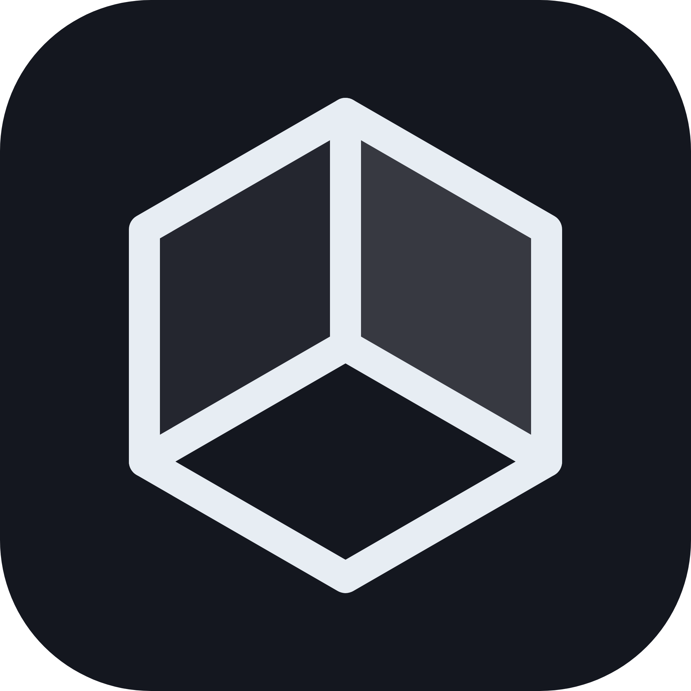

<div align="center">
  
  <h1>Agent 工具箱</h1>
  <p><strong>把 AI、科研、开发与桌面个性化，放进同一个工作台。</strong></p>
  <p>本地优先 · 可替换 AI 接口 · 模块化工具 · 可恢复的系统主题</p>

  [](https://github.com/guoshaung/agent-toolbox/releases)
  [](https://github.com/guoshaung/agent-toolbox/actions/workflows/release.yml)
  [](package.json)
  [](#平台支持)

  <p>
    <a href="https://github.com/guoshaung/agent-toolbox/releases">下载安装</a> ·
    <a href="#核心能力">功能概览</a> ·
    <a href="docs/SYSTEM-BEAUTY.md">系统主题</a> ·
    <a href="docs/DRAWING-SYNC.md">iPad 同步绘图</a> ·
    <a href="docs/FEATURES.md">使用指南</a> ·
    <a href="https://github.com/guoshaung/agent-toolbox/issues">反馈问题</a>
  </p>
</div>

---

Agent 工具箱是基于 Electron 的桌面应用，将网页 AI、DeepSeek Harness、文献阅读、代码学习、常用开发工具和 Windows 系统美化集中到一个可定制的工作空间。常用工具可以固定到侧栏，其余通过「更多」工具库访问。

配置、文献、主题素材与工作记录默认保存在本机。需要 AI、检索或在线服务时，再连接相应的服务提供方。项目由个人独立开发和维护，功能与支持范围以当前源码及对应 Release 为准。

## 核心能力

| 方向 | 可以做什么 | 主要入口 |
| --- | --- | --- |
| **AI 工作台** | DeepSeek 网页会话、OpenAI 兼容接口、DSH 内置控制台、聊天记录导出 | 快问 / DSH / 记录 |
| **额度与统一接口** | WorkBuddy 国内版、TRAE 国际版 IDE、豆包工作、QwenWork 国内版，本地兼容网关、各家额度与用量记录 | [额度中枢](docs/AI-HUB.md) |
| **科研与阅读** | 文献发现与管理、PDF 阅读与批注、Zotero 联动、科研绘图与 PPTX 导出 | 科研 |
| **代码与学习** | 模板默写、AI 出题、实践 Notebook、仓库阅读、代码陪读 | 学习 / 代码记事本 / 陪读 |
| **Skill 与 MCP** | 收藏提示词并补齐 Skill 格式、管理技能库、配置 MCP 服务 | Skill 工厂 / MCP |
| **开发与效率** | HTTP 调试、Git 操作、流量查看、文件收纳、任务与专注 | 接口台 / Git / 抓包台 / 收纳 / 专注 |
| **桌面与形象** | 应用皮肤、可恢复的电脑主题、VRM 形象、桌宠、OBS 窗口输出 | 皮肤 / 系统美化 / 形象输出 / 桌宠 |
| **设备与媒体** | 手机控制与文件互传、本地视频报告、Voicebox 启动与联动 | 手机 / 视频 / Voicebox |
| **iPad 同步绘图** | PencilKit 原生手写、笔迹与图片同步、PDF 底稿批注；配对后收起二维码 | 更多轮盘 → 绘图同步 → 同步绘图 |

完整操作说明见 [功能与操作指南](docs/FEATURES.md)。第三方应用、模型与服务按各自的安装要求和账号权限使用。

**iPad 同步绘图：** 电脑打开「同步绘图」，iPad 在同一 Wi-Fi 下扫码连接，复用原 Toolbox 设备 ID。支持 Safari 绘图与 [PencilKit 原生 iPad 应用](mobile/ipad/README.md)，笔迹和粘贴图片双向同步。网页包含可调压感、平滑笔迹与掌触过滤；原生 IPA 需自行签名安装，Apple Pencil 真机手感待验证。详见 [连接与功能范围](docs/DRAWING-SYNC.md)。

## 系统主题：选择、应用、恢复

**入口：「更多」→「设备外观」→「系统美化」。** 可将该工具固定到侧栏。

导入自己的图片与人物素材，调整搭配并保存主题；应用时按需勾选作用范围，一次切换电脑外观。连续更换主题会保留首次应用前的恢复点。

| 主题范围 | 当前能力 |
| --- | --- |
| 桌面壁纸 | 底图与透明人物合成，支持原创渐变与本地图片 |
| 资源管理器 | 文件区域背景与人物叠加；显示组件注册、加载及绘制状态 |
| 应用窗口 | 圆角、标题栏深浅色、云母 / 亚克力；符合条件的新窗口自动跟随 |
| 系统图标 | 此电脑、文档、网络、空 / 满回收站与普通文件夹，共 6 项 |
| 鼠标指针 | 15 类配套指针，包含忙碌与后台工作的动画指针 |
| 配色与任务栏 | 人物自动取色、Windows 强调色，以及通过 TranslucentTB 提供的任务栏材质 |
| 主题交换 | 导入 / 导出 `.toolbox-theme.json`，包含搭配素材与来源署名 |

**使用步骤**

1. 导入素材或选择本机已有预设，检查人物、底图和配色。
2. 在「切换电脑主题」勾选范围，点击「应用主题到电脑」，或在预设卡片点击「应用这套电脑主题」。
3. 点击顶部「恢复应用前电脑外观」统一撤销；部分恢复失败时会保留记录，便于重试。

主题模块的素材与恢复数据独立保存，不修改工具箱原有字体、API Key 和偏好。首次启用资源管理器组件可能需要 Windows 管理员授权；任务栏组件首次使用需要下载。普通切换与恢复复用已安装的组件。

**兼容范围：** 完整窗口材质以 Windows 11 22H2 及以上版本为目标；应用自绘界面可能遮挡材质。开始菜单与右键菜单目前调整配色，尚未替换布局。桌面轻动效为可选实验功能，背景层不兼容时保留静态壁纸。恢复外观与卸载原生组件是两个独立操作。

仓库与安装包不附带用户下载的角色预设、原版 MToolBox 二进制或第三方画作。已有预设通过本机素材库使用；素材获取与分享需遵循原作者授权。组件机制、数据位置与限制见 [系统美化文档](docs/SYSTEM-BEAUTY.md)。

## 安装与首次使用

从 [GitHub Releases](https://github.com/guoshaung/agent-toolbox/releases) 选择对应版本与平台，核对该版本的发布说明和附件。

| 平台 | 安装方式 |
| --- | --- |
| Windows x64 | 下载 `Agent-Toolbox-版本号-win-x64.exe`，按安装向导完成安装 |
| macOS Apple Silicon | 下载对应 `mac-arm64.dmg`；是否提供签名及更新能力以该 Release 为准 |

首次打开后：

1. **选择 AI 接口。** 在「快问」登录 DeepSeek 网页，或到「设置 → AI 接口」填写兼容服务的 Base URL、API Key 和模型名。学习出题模型可单独配置。
2. **整理常用工具。** 在「更多」工具库中查找工具，点击星标固定到侧栏。
3. **按需启用扩展。** DSH、Voicebox、手机控制和系统美化分别在自己的工具页面配置。

DSH 会复用本机已有的服务，或尝试下载并启动 `@deepseek-ai/dsh`；首次自动部署需要 Node.js/npm 和网络。Voicebox 需另行安装官方应用。网页服务和 API 的额度、价格及可用性由各服务方决定。

### 收藏自己的 Skill

打开 **「Skill 工厂 → 我喜欢的」**，粘贴提示词、操作步骤或完整 `SKILL.md`，点击「加入我喜欢的」。普通文本会自动补齐所需格式；完整 Skill 文件保留原内容。需要使用时选择输出目录，点击「装到目录」。多文件技能引用的脚本、图片与参考资料需要一并复制。

### 更新与数据保留

Windows 安装版会定期检查更新，确认后才下载。下载完成可立即重启安装，或在下次正常退出时安装；开发模式不检查更新。实际可用版本以 Releases 为准，当前分支可能包含尚未发布的功能。

个人设置与素材保存在 Electron 的 `userData`，独立于安装目录。升级与重新构建应保留该数据目录；跨电脑迁移前请先备份。API Key 通过系统安全存储加密，复制配置文件不等于可以在另一台电脑解密使用。

## 平台支持

| 能力 | Windows x64 | macOS arm64 |
| --- | --- | --- |
| AI、文档、学习与常用工具 | 支持，外部依赖按需安装 | 支持，外部依赖按需安装 |
| 系统主题原生应用与恢复 | 支持；部分效果需 Windows 11 22H2+ | 不支持 Windows 原生效果 |
| 跨应用窗口吸附 | 不支持 macOS 专用实现 | 支持 |
| 源码构建 | NSIS 安装包 | DMG / ZIP |

发布工作流包含 Windows 与 macOS 构建；这表示构建目标，不能替代具体版本的兼容性验证。未签名的 macOS 应用不支持自动安装更新。

## 开发与构建

需要 Git、Node.js 和 npm；仓库 CI 使用 Node.js 22。原生扩展的开发要求见对应模块文档。

```bash
git clone https://github.com/guoshaung/agent-toolbox.git
cd agent-toolbox
npm ci
npm start
```

| 命令 | 用途 |
| --- | --- |
| `npm run dev` | 以开发模式启动 |
| `npm test` | 运行测试目录中的测试 |
| `npm run check` | 执行主入口语法检查与测试；发布工作流使用此命令 |
| `npm run dist:win -- --publish never` | 构建 Windows x64 安装包，不上传 |
| `node scripts/verify-update-artifacts.js` | 校验 Windows 安装包、blockmap 与更新元数据 |
| `npm run dist -- --publish never` | 在 macOS 构建 DMG / ZIP，不上传 |

Windows 更新产物包括安装包、同名 `.exe.blockmap` 与 `latest.yml`。发布流程中的测试、构建或产物校验失败会中止发布。详见 [发布工作流](.github/workflows/release.yml)。

修改渲染界面后可从设置中重载界面；修改主进程代码后需要重启应用。

```text
src/
├── main/                  主进程、IPC、配置与原生能力
│   ├── main.js            应用入口
│   ├── preload.js         渲染进程能力接口
│   └── beauty-*.js        主题应用、组件与恢复逻辑
└── renderer/
    ├── core/registry.js   工具注册表
    ├── styles/            界面样式
    └── tools/             独立工具模块
docs/                      使用说明与设计文档
scripts/                   构建、校验与维护脚本
test/                      自动化测试
```

界面使用原生 JavaScript、CSS 与 SVG；桌面运行时为 Electron，发布使用 electron-builder。文献、公式和图形能力使用 PDF.js、KaTeX、Three.js 等依赖，版本以 [package.json](package.json) 和锁文件为准。

## 数据与隐私

- **本机保存：** 普通配置位于 `userData/config.json`；系统主题数据位于 `userData/system-beauty/`。文献、素材和工作记录按模块保存。
- **凭据保护：** API Key 通过 Electron `safeStorage` 加密；不应将配置、登录缓存或运行日志中的敏感内容提交到仓库。
- **网络边界：** 使用网页 AI、API、论文检索、在线工具或下载时，相应内容与请求会发送至选定服务；“本地优先”不代表所有功能离线运行。
- **系统变更：** 美化功能在用户应用后执行；恢复数据用于还原由模块管理的项目，失败项保留记录并提供重试。

## 文档与反馈

| 文档 | 内容 |
| --- | --- |
| [功能与操作指南](docs/FEATURES.md) | 学习、科研、手机控制、媒体、形象与常用操作 |
| [系统美化](docs/SYSTEM-BEAUTY.md) | 主题范围、原生组件、恢复机制及兼容限制 |
| [桌宠](docs/DESKTOP-PET.md) | 桌宠与代码快速解释 |
| [新增工具](docs/ADD-A-TOOL.md) | 模块接入与工具注册 |
| [需求与设计](docs/SPEC.md) | 产品需求和设计取舍 |
| [发布记录](RELEASE-NOTES.md) | 仓库内的版本变更记录 |

欢迎通过 [Issues](https://github.com/guoshaung/agent-toolbox/issues) 提交问题或建议。请附应用版本、操作系统、复现步骤和经过脱敏的错误信息；提交修改前请说明影响范围及验证方式。

第三方组件与素材遵循各自许可；本仓库当前未提供统一的顶层 LICENSE，代码公开可读不等同于授予任意再分发许可。VRM 样例来源见 [模型来源与授权](assets/avatar-model-thumbnails/README.md)，原生组件与外部工具说明见相应模块文档。
